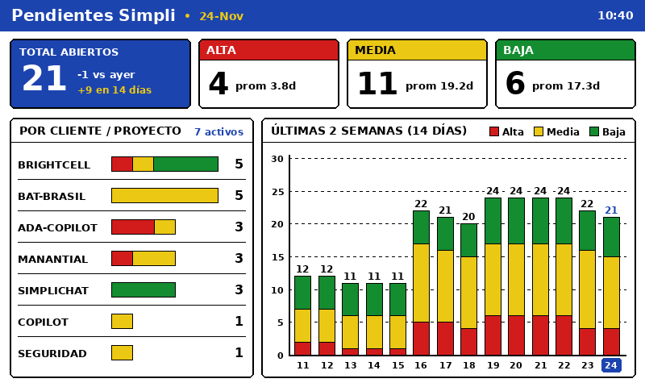
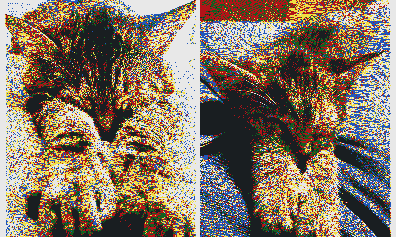
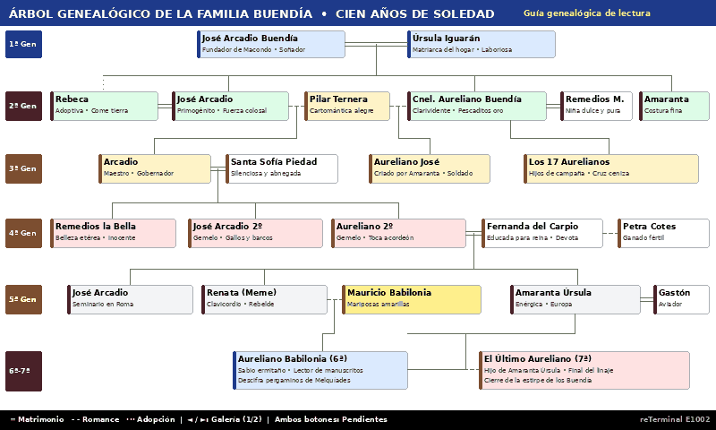
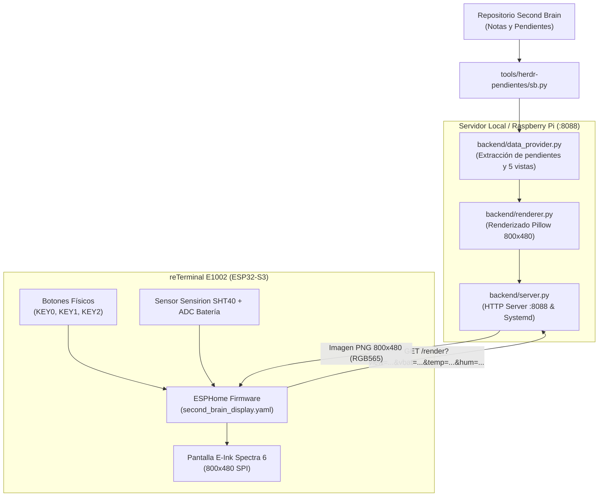

# 📟 Second Brain Display — Pendientes Simpli (reTerminal E1002)

Visualizador de escritorio Always-On, de **ultra-alta legibilidad**, sin retroiluminación ni emisión de luz azul, diseñado específicamente para la pantalla de tinta electrónica a color **E-Ink® Spectra™ 6 (800×480)** del **Seeed Studio reTerminal E1002**.

Muestra en tiempo real las estadísticas de pendientes del segundo cerebro de SimpliRoute (`estadistica.py`: total abierto, desglose por prioridad, pendientes por cliente/proyecto y evolución consolidada de las últimas 2 semanas), sincronizándose automáticamente por Wi-Fi con un backend ligero que corre en un servidor local o Raspberry Pi.

---

## 📸 Vista Principal (800 × 480 px)

### Dashboard de Estadísticas (`00_estadistica.png`)
Vista única de alta legibilidad sin paginación ni barra inferior:
- **Header único (38 px, azul)**: marca + fecha corta a la izquierda; temperatura, humedad, hora e ícono dinámico de batería a la derecha.
- **Franja KPI superior**: tarjeta `TOTAL ABIERTOS` con deltas (`vs ayer` y `en 14 días`) + tarjetas `ALTA`, `MEDIA` y `BAJA` con edad promedio.
- **Abajo izquierda (`POR CLIENTE / PROYECTO`)**: barras horizontales apiladas por prioridad y total por cliente/proyecto activo (colapsa el excedente en `OTROS (+K)` si supera 7 activos).
- **Abajo derecha (`ÚLTIMAS 2 SEMANAS`)**: gráfica de barras apiladas de los últimos 14 días por prioridad (`Alta` en la base, `Media` al medio, `Baja` arriba).



---

## 🖼️ Modo Galería de Imágenes (800 × 480 px Full-Bleed)

Pulsando **ambos botones blancos a la vez (Izquierdo + Derecho)**, el dispositivo conmuta al **Modo Galería**, permitiendo disfrutar de láminas artísticas e infografías a pantalla completa sin elementos invasivos de interfaz ni barras negras:

### Lámina 1: Fotografía Artística (Gatito Panterita)
Fotografía de gato negro con sombras levantadas (curva gamma calculada desde la propia foto), contraste local en el pelaje y realce de bigotes, tramada Floyd-Steinberg a negro/blanco puros (PNG de 1 bit, 40.3 KB).


### Lámina 2: Gatitos Durmiendo (collage a color)
Collage de dos fotos de un gatito atigrado, tramado Floyd-Steinberg a las 6 tintas con un tratamiento suave (sin contraste local, para que el pelaje no se llene de ruido). Pesa 124 KB; el PNG se descarga en streaming, así que el buffer de 64 KB no lo limita.


### Última lámina: Árbol Genealógico Buendía (*Cien años de soledad*)
Póster de seis generaciones con marco ornamental, mariposas amarillas y medallones: negros con centro amarillo para los Buendía de sangre, blancos para quienes llegan a la familia. Muestra solo nombres y relaciones (matrimonio, unión, adopción); llega hasta Aureliano Babilonia y **no revela el desenlace**. Se dibuja con las 6 tintas exactas y texto sin antialias (7 KB).


El orden de la galería es el orden alfabético de los archivos de `backend/gallery/`. El árbol se llama `99_cien_anos_arbol.png` para quedar siempre último.

**Agregar una foto a la galería.** El driver `epaper_spi` de ESPHome no tramea: fuerza cada píxel a una de las 6 tintas con un umbral duro. Por eso el script entrega la imagen ya tramada a las tintas puras:
```bash
.venv/bin/python projects/second_brain_display/backend/adapt_gallery_image.py FOTO.jpg \
  projects/second_brain_display/backend/gallery/03_nombre.png --preview projects/second_brain_display/backend/previews/nombre.png \
  [--mode auto|bn|bayer|acento|color] [--crop x0,y0,x1,y1]
```
`auto` usa B/N para las fotos casi grises y las 6 tintas para las coloridas. La vista previa simula las tintas reales del panel.

---

## 🎨 Principios de Diseño para Pantallas E-Ink Spectra 6

A diferencia de un monitor LCD/OLED, una pantalla electroforética como la **Spectra 6** mueve partículas físicas de pigmento dentro de microcápsulas. Las fuentes delgadas, grises claros o elementos con bajo contraste sufren de desenfoque y "empastado" (*color bleeding*).

Para lograr una legibilidad perfecta a 1 metro de distancia en el escritorio:

1. **Tipografía Gruesa y Pesada**:
   - Se estandarizó el uso de **`DejaVuSans-Bold`** en todos los textos.
   - Tamaños mínimos garantizados: **14 px** en pie de página, **15 px** en badges/subtítulos, **19–20 px** en títulos de tarjetas y encabezados de sección, **22 px** en cabecera principal y **36 px** en cifras de KPIs.
   - No se utilizan fuentes delgadas (*Light* o *Regular*) en tamaños pequeños.
2. **Paleta Cromática Spectra 6 Pura**:
   - **Azul Primario** (`#1E3A8A` / RGB `30, 58, 138`): Cabecera principal y etiquetas de clientes.
   - **Rojo Intenso** (`#DC2626` / RGB `220, 38, 38`): KPIs de alta prioridad y vencimientos críticos (*Hoy*).
   - **Amarillo Ámbar** (`#D97706` / RGB `217, 119, 6`): KPIs y badges de media prioridad.
   - **Verde Bosque** (`#166534` / RGB `22, 101, 52`): KPIs y badges de baja prioridad.
   - **Fondo de Tarjetas** (`#F3F4F6` / RGB `243, 244, 246`): Gris muy claro para delimitar áreas sin ensuciar el blanco.
   - **Negro Puro** (`#000000`): Texto principal, líneas separadoras y fondo del pie de página.
   - **Blanco Puro** (`#FFFFFF`): Fondo general y textos sobre fondos oscuros.
3. **Estructura y Proporciones de Pantalla (800 × 480 px)**:
   - **Cabecera Superior Única (38 px - Azul)**:
     - Izquierda: `Pendientes Simpli • DD-Mes` (20 px / 14 px Bold).
     - Derecha: Condiciones ambientales del sensor SHT40 (`XX.X°C • XX% RH`), hora de última actualización e **ícono dinámico de batería** con relleno proporcional y color semántico (**verde** > 15%, **rojo** ≤ 15%).
   - **Cuerpo Principal (442 px - Blanco, sin pie de página)**:
     - Franja superior de 4 tarjetas KPI (`TOTAL ABIERTOS`, `ALTA`, `MEDIA`, `BAJA`) + dos paneles inferiores (`POR CLIENTE / PROYECTO` y gráfica apilada de `ÚLTIMAS 2 SEMANAS`).

---

## 🏗️ Arquitectura del Sistema



---

## ⚙️ Características del Firmware (ESPHome)

El archivo de configuración [`firmware/second_brain_display.yaml`](firmware/second_brain_display.yaml) incluye:

1. **Mapeo Físico de Botones (Perspectiva Frontal) y Atajo Combo**:
   - **Pulsación Simultánea (Izquierdo + Derecho / KEY2 + KEY1)**: Conmuta de modo entre **Pendientes Simpli** y **Galería de Imágenes** con un doble tono confirmatorio y parpadeo LED. El modo activo y la lámina actual quedan guardados de forma persistente en memoria (`restore_value: true`), garantizando que la imagen elegida permanezca indefinidamente en pantalla hasta que se vuelva a presionar la combinación de botones.
   - **Botón Blanco Izquierdo (`GPIO5 / KEY2`)**: 
     - En *Modo Pendientes*: Retrocede a la vista anterior (`(view_index - 1 + 5) % 5`).
     - En *Modo Galería*: Retrocede a la imagen anterior de la galería.
   - **Botón Blanco Derecho (`GPIO4 / KEY1`)**: 
     - En *Modo Pendientes*: Avanza a la vista siguiente (`(view_index + 1) % 5`).
     - En *Modo Galería*: Avanza a la imagen siguiente de la galería.
   - **Botón Verde Superior (`GPIO3 / KEY0`)**: Sincronización/refresco inmediato de la pantalla actual (funciona en ambos modos).
2. **Modo Galería y Árbol Genealógico sin Spoilers**:
   - Galería de láminas gráficas optimizadas para Spectra 6 (800×480 px).
   - Primera lámina integrada: **Árbol Genealógico de la familia Buendía (*Cien años de soledad*)**, con estructura por generaciones, rasgos simbólicos de cada personaje (mariposas amarillas, pescaditos de oro, cruz de ceniza) y estricto filtro anti-spoilers para acompañar la lectura del libro.
3. **Horario Inteligente y Modo Galería Nocturno / Fin de Semana**:
   - Sincronización horaria automática por red mediante **SNTP** (`America/Santiago`).
   - **Horario Laboral (Lunes a Viernes de 08:45 a 19:00)**: A las 08:45 activa automáticamente el **Modo Pendientes** y refresca cada 15 minutos entre 09:00 y 18:45. Ese refresco solo redibuja si cambiaron las pendientes de la vista en pantalla (si no, el backend responde `304`). Los botones y el arranque siempre redibujan.
   - **Noches y Fines de Semana**: A las 19:00 conmuta automáticamente a **Modo Galería** (arte / cuadro digital) y suspende los refrescos periódicos laborales para descansar la pantalla y ahorrar energía. Al arrancar fuera de horario laboral, detecta el horario tras sincronizar el reloj y pasa directo a Galería.
   - **Deep sleep fuera de horario**: 3 minutos después del último refresco o botón, el ESP32 se duerme (la tinta conserva la imagen) hasta las 08:45 del próximo día hábil. Despierta cada 4 h solo para corregir el reloj, sin redibujar. Cualquier botón lo despierta: el verde redibuja, y los laterales avanzan o retroceden la lámina. Después de un botón quedan 3 minutos despierto, que sirven también para flashear por OTA. El combo de los dos botones solo funciona estando despierto.
   - Si el usuario conmuta manualmente entre modos, el refresco periódico respeta el modo elegido.
3. **Telemetría Bidireccional Integrada**:
   - En cada refresco o cambio de vista, el reTerminal adjunta sus lecturas en la URL:
     `http://<IP_SERVIDOR>:8088/render?view=resumen&vbat=4.11&temp=26.5&hum=48.0`
   - El backend registra la telemetría, dibuja el porcentaje de batería en la cabecera y la temperatura/humedad en el pie, y la expone en la API JSON.
4. **Actualizaciones Inalámbricas (OTA)**:
   - Soporte nativo para flasheo por Wi-Fi sin necesidad de conectar el dispositivo por cable USB a la computadora.

---

## 🚀 Despliegue y Comandos Útiles

### 1. Backend en el Servidor / Raspberry Pi

El backend corre como un servicio systemd de usuario:

```bash
# Estado del servicio
systemctl --user status second-brain-display.service

# Reiniciar servicio tras cambios de código
systemctl --user restart second-brain-display.service

# Ver logs en tiempo real
journalctl --user -u second-brain-display.service -f
```

### 2. Simulador Web y API

Puedes previsualizar el panel desde cualquier navegador conectado a la red local:

* **Dashboard Web y Simulador Interactivo:** `http://<IP_SERVIDOR>:8088/`
* **Endpoint de Imagen para el reTerminal:** `http://<IP_SERVIDOR>:8088/render?view=resumen`
* **Endpoint JSON de Datos y Telemetría:** `http://<IP_SERVIDOR>:8088/api/pendientes`

### 3. Compilación y Flasheo de Firmware

```bash
# Flasheo inicial por cable USB (ej. desde pop-os o Raspberry Pi)
.venv/bin/esphome run projects/second_brain_display/firmware/second_brain_display.yaml --device /dev/ttyUSB0

# Flasheo OTA inalámbrico automático (detecta la IP viva por telemetría)
./scripts/flash_ota.sh

# O flasheo OTA manual indicando IP:
./scripts/flash_ota.sh --ip <IP_DISPOSITIVO>
```

Para consultar los detalles de arquitectura de bajo nivel, el límite de 64 KB de buffer ePaper y el algoritmo de coincidencia de botones, revisa:
👉 [Bitácora de Lecciones Aprendidas (OTA y Firmware)](../../docs/LESSONS_LEARNED_OTA_AND_FIRMWARE.md).
