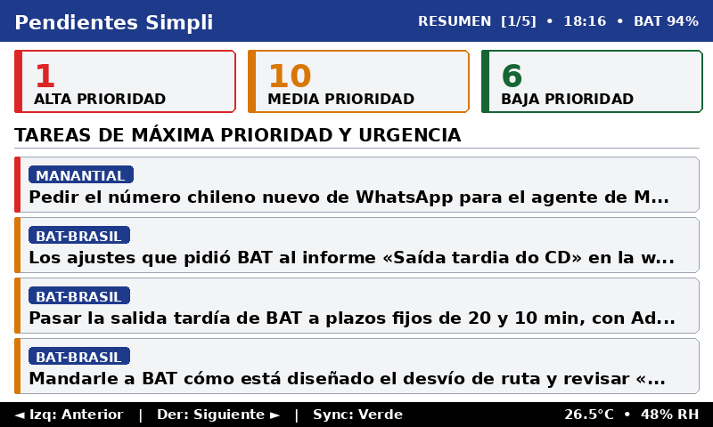
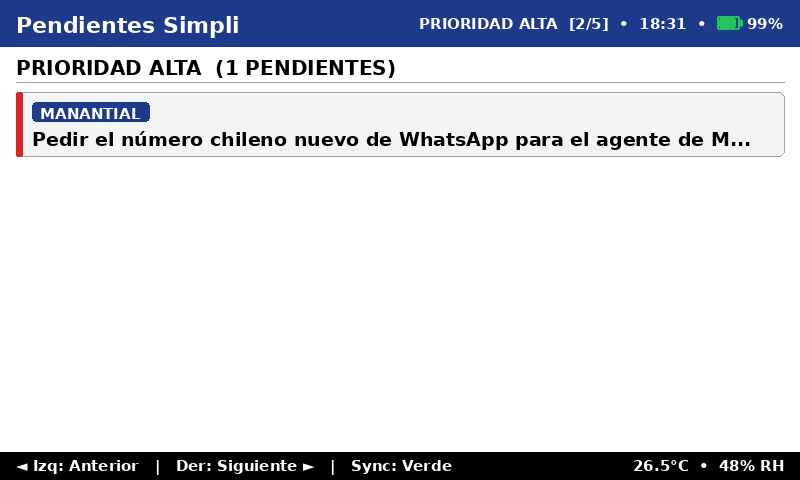
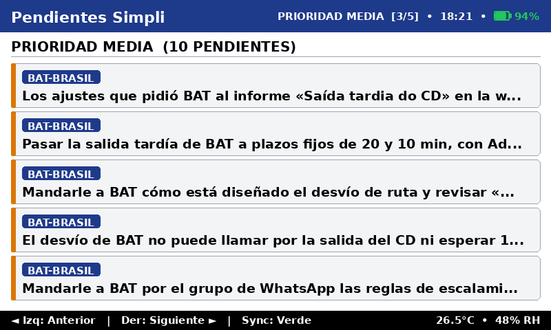
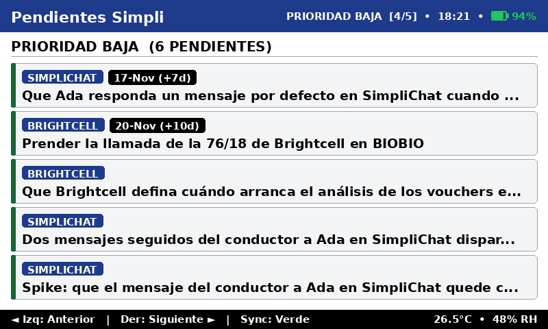
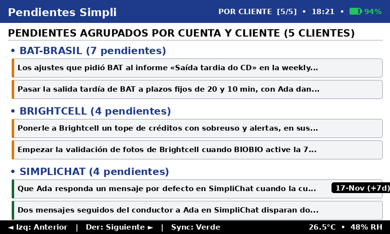
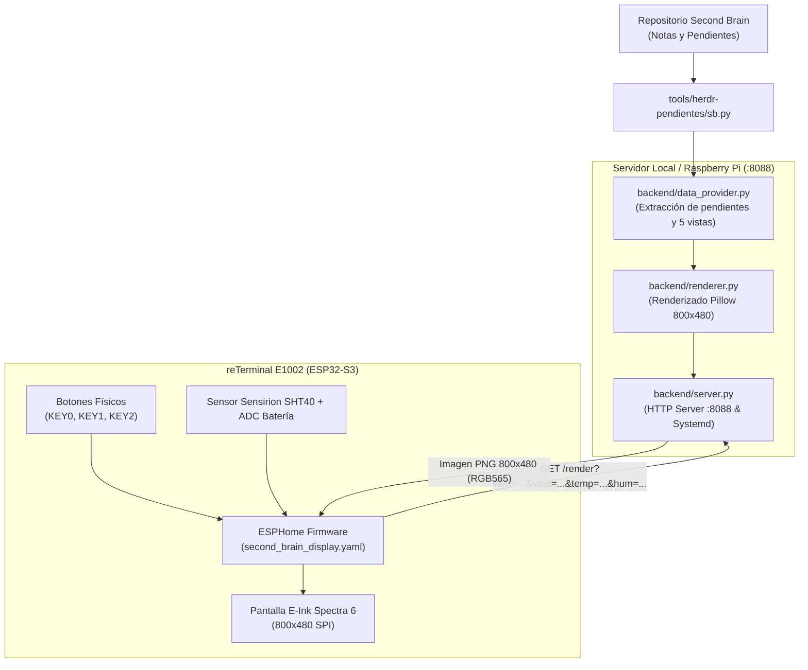

# 📟 Second Brain Display — Pendientes Simpli (reTerminal E1002)

Visualizador de escritorio Always-On, de **ultra-alta legibilidad**, sin retroiluminación ni emisión de luz azul, diseñado específicamente para la pantalla de tinta electrónica a color **E-Ink® Spectra™ 6 (800×480)** del **Seeed Studio reTerminal E1002**.

Muestra en tiempo real los pendientes, prioridades, vencimientos y estados de cuentas del segundo cerebro de SimpliRoute, sincronizándose automáticamente por Wi-Fi con un backend ligero que corre en un servidor local o Raspberry Pi.

---

## 📸 Galería Visual de Vistas (800 × 480 px)

El sistema cuenta con **5 vistas navegables** mediante los botones físicos del dispositivo:

### 1. Vista Resumen (`1/5`)
Cajas de indicadores clave (KPIs) con conteos por prioridad (Alta, Media, Baja) y las 4 tareas de máxima urgencia con pastillas de cliente y vencimientos destacados.


### 2. Vista Alta Prioridad (`2/5`)
Listado detallado de tareas críticas que requieren atención prioritaria o inmediata.


### 3. Vista Media Prioridad (`3/5`)
Tareas operativas y de seguimiento a mediano plazo.


### 4. Vista Baja Prioridad (`4/5`)
Backlog de tareas y pendientes secundarios.


### 5. Vista Por Cliente (`5/5`)
Pendientes organizados jerárquicamente por cliente y cuenta (Falabella, Bidfood, Walmart, etc.), facilitando la preparación de reuniones y seguimiento por cuenta.


---

## 🎨 Principios de Diseño para Pantallas E-Ink Spectra 6

A diferencia de un monitor LCD/OLED, una pantalla electroforética como la **Spectra 6** mueve partículas físicas de pigmento dentro de microcápsulas. Las fuentes delgadas, grises claros o elementos con bajo contraste sufren de desenfoque y "empastado" (*color bleeding*).

Para lograr una legibilidad perfecta a 1 metro de distancia en el escritorio:

1. **Tipografía Gruesa y Pesada**:
   - Se estandarizó el uso de **`DejaVuSans-Bold`** en todos los textos.
   - Tamaños mínimos garantizados: **14 px** en pie de página, **15 px** en badges/subtítulos, **19–20 px** en títulos de tarjetas y encabezados de sección, **22 px** en cabecera principal y **36 px** en cifras de KPIs.
   - No se utilizan fuentes delgadas (*Light* o *Regular*) en tamaños pequeños.
2. **Paleta Cromática Spectra 6 Pura**:
   - **Azul Primario** (`#1E3A8A` / RGB `30, 58, 138`): Cabecera principal y etiquetas de clientes.
   - **Rojo Intenso** (`#DC2626` / RGB `220, 38, 38`): KPIs de alta prioridad y vencimientos críticos (*Hoy*).
   - **Amarillo Ámbar** (`#D97706` / RGB `217, 119, 6`): KPIs y badges de media prioridad.
   - **Verde Bosque** (`#166534` / RGB `22, 101, 52`): KPIs y badges de baja prioridad.
   - **Fondo de Tarjetas** (`#F3F4F6` / RGB `243, 244, 246`): Gris muy claro para delimitar áreas sin ensuciar el blanco.
   - **Negro Puro** (`#000000`): Texto principal, líneas separadoras y fondo del pie de página.
   - **Blanco Puro** (`#FFFFFF`): Fondo general y textos sobre fondos oscuros.
3. **Estructura y Proporciones de Pantalla (800 × 480 px)**:
   - **Cabecera Superior (46 px - Azul)**:
     - Izquierda: `Pendientes Simpli` (22 px Bold).
     - Derecha: Nombre de vista y número `[X/5]`, hora de última actualización e **ícono dinámico de batería** con relleno proporcional y color semántico (**verde** > 15%, **rojo** ≤ 15%).
   - **Cuerpo Central (376 px - Blanco con tarjetas grises)**:
     - Separación de 6 px entre tarjetas, bordes redondeados y márgenes interiores (*padding*) de alto contraste.
   - **Pie de Página (28 px - Negro)**:
     - Izquierda: Guía de botones físicos: `◄ Izq: Anterior | Der: Siguiente ► | Sync: Verde`.
     - Derecha: Condiciones ambientales del sensor SHT40: `XX.X°C • XX% RH`.

---

## 🏗️ Arquitectura del Sistema



---

## ⚙️ Características del Firmware (ESPHome)

El archivo de configuración [`firmware/second_brain_display.yaml`](firmware/second_brain_display.yaml) incluye:

1. **Mapeo Físico de Botones (Perspectiva Frontal)**:
   - **Botón Blanco Izquierdo (`GPIO5 / KEY2`)**: Retrocede a la vista anterior (`(view_index - 1 + 5) % 5`) con pitido de confirmación (30% volumen, 40 ms).
   - **Botón Blanco Derecho (`GPIO4 / KEY1`)**: Avanza a la vista siguiente (`(view_index + 1) % 5`) con pitido de confirmación (30% volumen, 40 ms).
   - **Botón Verde Superior (`GPIO3 / KEY0`)**: Sincronización inmediata forzada (`fetch_view`) con pitido medio (40% volumen, 60 ms).
2. **Horario Inteligente de Refresco (Ahorro de Batería y Pantalla)**:
   - Sincronización horaria automática por red mediante **SNTP** (`America/Santiago`).
   - El refresco automático ocurre cada 15 minutos **exclusivamente de Lunes a Viernes entre 08:45 y 19:00 hrs**:
     - `08:45`: Refresco inicial de apertura de jornada laboral.
     - `09:00` a `18:45`: Refresco periódico cada 15 minutos.
     - `19:00`: Refresco final de cierre de jornada.
   - **Noches y Fines de Semana**: Cero refrescos automáticos. La pantalla E-Ink permanece estática consumiendo 0 vatios, ahorrando batería y ciclos de vida útil del panel. La interacción manual por botones sigue disponible 24/7.
3. **Telemetría Bidireccional Integrada**:
   - En cada refresco o cambio de vista, el reTerminal adjunta sus lecturas en la URL:
     `http://<IP_SERVIDOR>:8088/render?view=resumen&vbat=4.11&temp=26.5&hum=48.0`
   - El backend registra la telemetría, dibuja el porcentaje de batería en la cabecera y la temperatura/humedad en el pie, y la expone en la API JSON.
4. **Actualizaciones Inalámbricas (OTA)**:
   - Soporte nativo para flasheo por Wi-Fi sin necesidad de conectar el dispositivo por cable USB a la computadora.

---

## 🚀 Despliegue y Comandos Útiles

### 1. Backend en el Servidor / Raspberry Pi

El backend corre como un servicio systemd de usuario:

```bash
# Estado del servicio
systemctl --user status second-brain-display.service

# Reiniciar servicio tras cambios de código
systemctl --user restart second-brain-display.service

# Ver logs en tiempo real
journalctl --user -u second-brain-display.service -f
```

### 2. Simulador Web y API

Puedes previsualizar el panel desde cualquier navegador conectado a la red local:

* **Dashboard Web y Simulador Interactivo:** `http://<IP_SERVIDOR>:8088/`
* **Endpoint de Imagen para el reTerminal:** `http://<IP_SERVIDOR>:8088/render?view=resumen`
* **Endpoint JSON de Datos y Telemetría:** `http://<IP_SERVIDOR>:8088/api/pendientes`

### 3. Compilación y Flasheo de Firmware

```bash
# Flasheo inicial por cable USB
.venv/bin/esphome run projects/second_brain_display/firmware/second_brain_display.yaml --device /dev/ttyUSB0

# Actualizaciones inalámbricas por Wi-Fi (OTA)
.venv/bin/esphome run projects/second_brain_display/firmware/second_brain_display.yaml --device <IP_DISPOSITIVO>
```
